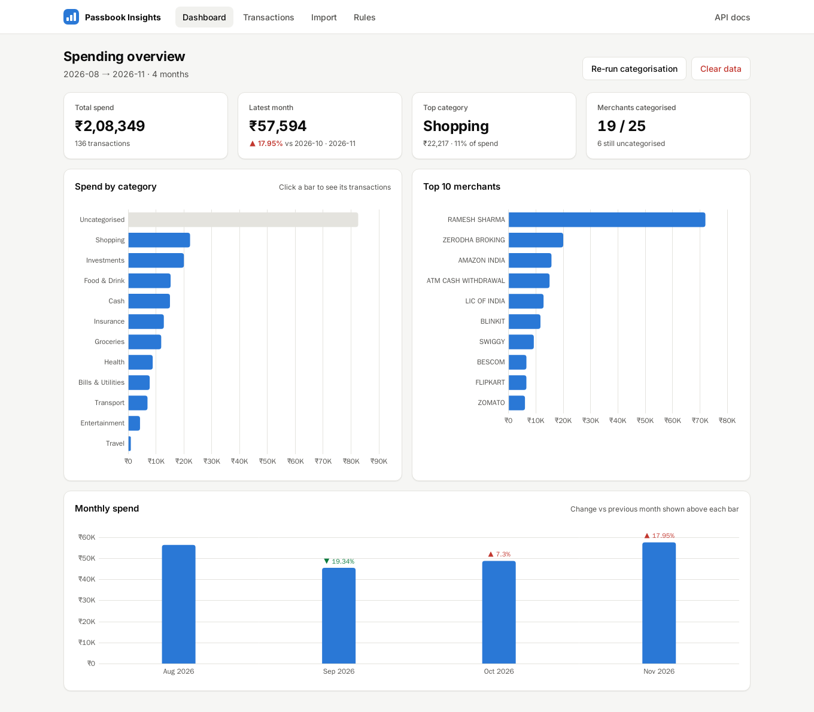
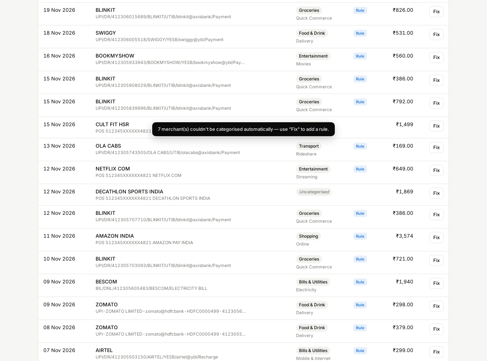
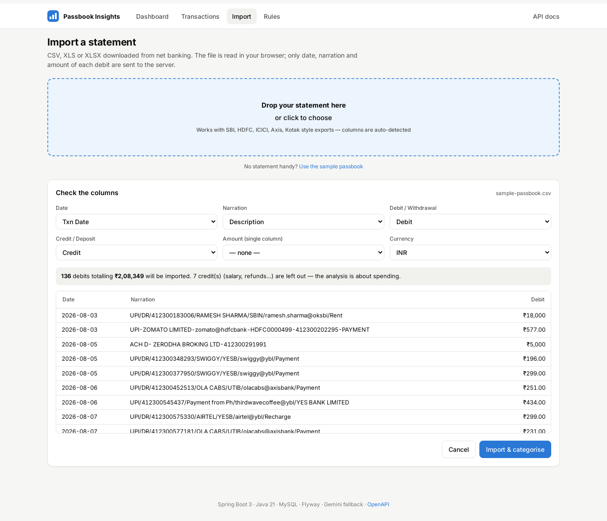
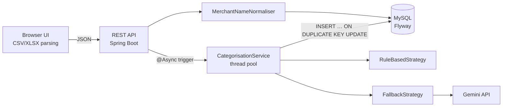

# Passbook Insights — Transaction Ingestion & Categorisation Engine

Upload a bank statement (CSV / Excel from net banking) and get categorised spending
analytics. A Spring Boot 3 service ingests transactions in bulk, cleans raw bank
narrations into merchant names, categorises each merchant with configurable keyword
rules and falls back to an LLM (Google Gemini) for anything the rules don't know.

**Live demo:** https://passbook-insights.onrender.com · **API docs:** [Swagger UI](https://passbook-insights.onrender.com/swagger-ui.html)



<details>
<summary>More screenshots</summary>

**Transactions** — raw narration under each cleaned merchant, with how it was categorised



**Import** — columns are auto-detected; only debits are analysed


</details>

---

## What it does

1. **Import** a statement in the browser. The header row and the Date / Narration /
   Debit / Credit columns are detected automatically (SBI, HDFC, ICICI, Axis and
   Kotak style exports, CSV or XLS/XLSX). Only debits are sent to the API.
2. **Normalise** each narration into a stable merchant key, so the same merchant is
   categorised once however many reference numbers the bank wraps around it:

   | Raw narration | Merchant |
   |---|---|
   | `UPI/DR/412345678901/SWIGGY/YESB/swiggy@ybl/Payment` | `SWIGGY` |
   | `UPI-ZOMATO LIMITED-zomato@hdfcbank-HDFC0000001-4123…` | `ZOMATO` |
   | `UPI/4123…/Payment from Ph/swiggy@ybl/YES BANK LIMITED` | `SWIGGY` |
   | `ACH D- BAJAJ FINANCE LTD-0000123456` | `BAJAJ FINANCE` |
   | `ATM WDL/12345/MG ROAD BANGALORE` | `ATM CASH WITHDRAWAL` |

   On the 143-row sample passbook this reduces 136 debit lines to 25 distinct merchants.
3. **Categorise** merchants asynchronously on a thread pool. Keyword rules are tried
   first (deterministic, confidence 1.0); unmatched merchants go to Gemini, which
   returns `{ category, sub_category, confidence }`.
4. **Analyse**: spend by category, top 10 merchants, month-over-month change, plus
   a filterable, paginated transaction list.
5. **Correct**: "Fix" on any transaction creates a rule and re-applies the rules to
   every merchant, overriding earlier rule or AI results.

## Architecture



## Tech stack

| Concern        | Choice                                                          |
|----------------|-----------------------------------------------------------------|
| Language       | Java 21                                                         |
| Framework      | Spring Boot 3.5 (Web, Data JPA, Validation, Actuator)           |
| Database       | MySQL 8, schema managed by **Flyway** (versioned SQL)           |
| Async          | `@Async` + configurable `ThreadPoolTaskExecutor`, `CompletableFuture` fan-out |
| LLM            | Google Gemini via Spring `RestClient`, retry with backoff on 429/503 |
| Frontend       | Plain HTML/CSS/JS served by Spring Boot, Chart.js, PapaParse, SheetJS |
| API docs       | springdoc-openapi (Swagger UI)                                  |
| Tests          | JUnit 5, Mockito, Testcontainers (MySQL), Awaitility            |
| Packaging      | Multi-stage Docker image · docker-compose · Render blueprint (runs on MySQL 8 or TiDB) |

## Run locally

Requires Docker only.

```bash
# optional: enables the AI fallback (free key: https://aistudio.google.com/apikey)
echo "LLM_API_KEY=your-gemini-key" > .env

docker compose up --build
```

Open **http://localhost:8080** and click **Try with sample passbook**, or upload your own
statement. Everything runs on your machine, so this is the private way to analyse a
real passbook.

Without an LLM key, rule-based categorisation still works and unmatched merchants
show as *Uncategorised* until you add a rule.

To build or test without Docker you need **JDK 21** and `./mvnw`:

```bash
./mvnw test     # unit tests + Testcontainers integration test (needs Docker running)
```

## Configuration

| Variable | Default | Purpose |
|---|---|---|
| `DB_URL` / `DB_USERNAME` / `DB_PASSWORD` | local MySQL | Datasource |
| `LLM_API_KEY` | _(empty)_ | Gemini key; empty disables the AI fallback |
| `LLM_MODEL` | `gemini-2.5-flash` | Gemini model |
| `CATEGORISATION_POOL_CORE` / `_MAX` | `8` / `16` | Categorisation thread pool |
| `DB_POOL_MAX` | `50` | Hikari max connections |
| `APP_RESET_ENABLED` | `true` | Allow `DELETE /api/v1/transactions` |
| `PORT` | `8080` | HTTP port |

`categorization.fallback.enabled` in `application.yml` switches the LLM strategy on or off.

## API

Base path `/api/v1`. Full interactive reference at `/swagger-ui.html`.

| Method | Path | Description |
|---|---|---|
| `POST` | `/transactions/bulk` | Ingest a JSON array; per-row validation, returns accepted / rejected with reasons |
| `GET` | `/transactions` | Paginated list; filter by `category`, `source`, `dateFrom`, `dateTo` |
| `DELETE` | `/transactions` | Remove all transactions and merchant categories (rules kept) |
| `POST` | `/categorise/trigger` | Async categorisation of uncategorised merchants (`202`); `?recategorise=true` re-applies rules to all |
| `GET` | `/categorise/status` | `{ running, totalMerchants, uncategorisedMerchants }` |
| `GET` | `/analytics/summary` | Spend by category, top 10 merchants, month-over-month delta |
| `GET` | `/rules` | List rules by precedence |
| `POST` | `/rules` | Create or update a rule (upsert by keyword) |

Errors use one shape: `{ timestamp, status, error, message, path }`.

```bash
curl -X POST localhost:8080/api/v1/transactions/bulk -H 'Content-Type: application/json' -d '[
  {"merchantName":"UPI/DR/4123/SWIGGY/YESB/swiggy@ybl/Payment","amount":349,"currency":"INR","transactionDate":"2026-11-01","source":"IMPORT"},
  {"merchantName":"STARBUCKS NYC","amount":5.50,"currency":"USD","transactionDate":"2026-05-01","source":"BANK_FEED"}
]'
```

## Categorisation logic

`CategorisationService` (orchestrator) and `MerchantCategoriser` (per-merchant
transactional unit) implement the **Strategy pattern**:

1. **`RuleBasedStrategy`**: case-insensitive substring match of the merchant against
   active `category_rules`, lowest `priority` first (so `SWIGGY INSTAMART` beats
   `SWIGGY`). Confidence `1.0`, `strategy_used = RULE_BASED`.
2. **`FallbackStrategy`**: only when no rule matches and
   `categorization.fallback.enabled=true`. Calls Gemini with a structured prompt,
   extracts the JSON even if wrapped in prose or markdown, and clamps confidence to
   `[0, 1]`. `strategy_used = FALLBACK_LLM`. Failures leave the merchant
   uncategorised rather than failing the run.

How a run works:

- Active rules are loaded once per run and shared by all workers.
- Merchants are categorised in parallel on the configurable pool; a guard prevents
  overlapping runs.
- Each result is written with an atomic `INSERT … ON DUPLICATE KEY UPDATE` upsert
  keyed on the unique merchant name.

## Database migrations (Flyway)

| Script | Purpose |
|--------|---------|
| `V1__create_transactions.sql`        | `transactions` + indexes |
| `V2__create_merchant_categories.sql` | `merchant_categories`, unique merchant, confidence CHECK |
| `V3__create_category_rules.sql`      | `category_rules`, unique keyword |
| `V4__seed_category_rules.sql`        | Starter rules (global merchants) |
| `V5__statement_support.sql`          | Raw narration column + rules for common Indian merchants |

## Load testing

`load-tests/payload-10k.json` is a 10,000-row payload (with deliberately invalid
rows) for exercising bulk ingest and categorisation throughput.
